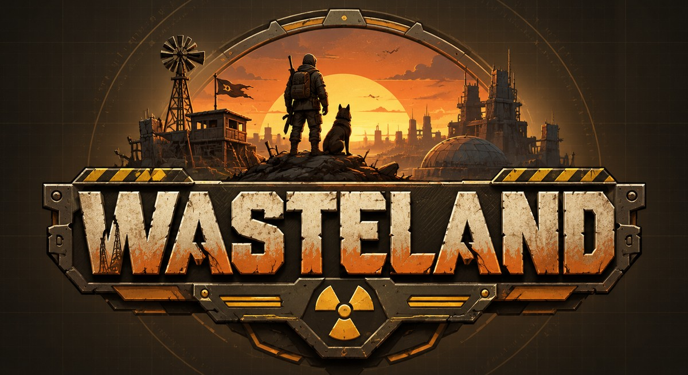

  

<h1 align="center">WASTELAND — Outpost 17</h1>

  <b>A post-apocalyptic, isometric settlement builder for the browser — half active, half idle.</b> 
  <a href="https://justplguy.github.io/WASTELAND/"><b>🌐 Website</b></a> ·
  <a href="https://discord.gg/atxXYTb63Z"><b>💬 Join the Discord</b></a> ·
  <a href="../../releases"><b>📜 Read the update notes</b></a>

---

After the Collapse, a handful of survivors hold on to a ruined roadside camp called **Outpost 17**.
You plan, build and make the hard calls when you play — and the settlement keeps working while you are away:
farms grow, teams scavenge the ruins, research finishes, contracts get done.
There is always a reason to come back for a few minutes.

> 📜 **This repository is the public development log of WASTELAND.**
> It contains no game files — every update is published here as a **[release](../../releases)** with full notes
> on what changed. The game itself is in closed development.
> Want to follow the project, give feedback or join the tests? **[Come to the Discord](https://discord.gg/atxXYTb63Z).**

---

## What the game is about

- 🏗️ **Build** — shelters, water collectors, farm plots, a scrap yard… and much more, once you find the plans.
- ⛓️ **Production chains** — rain water comes in dirty and must be purified; farms grow vegetables, grain and herbs
  that the kitchen, smokehouse and infirmary turn into meals and medicine; carpentry, forge, quarry and kiln make planks,
  metal, stone and bricks for the best upgrades.
- 📜 **Blueprints & research** — most buildings start unknown. Objectives reveal their blueprints;
  you research them for resources and real time.
- 🧑‍🤝‍🧑 **Know your people** — every survivor has a trait and gains experience in the work they do.
  Put the right person in the right place.
- 🗺️ **Explore** — send teams to the gas station, the residential ruins, the old warehouse, the clinic…
  Returning teams discover new places, bring loot and sometimes new survivors.
- ⚖️ **Decide** — travellers at the gate, storms, fevers, supply caches, raiders on the ridge.
- 📈 **Grow** — a campaign of chapters and objectives, a contract board, land clearing and settlement ranks
  (*Camp → Outpost → Settlement → Town → Haven*) with permanent perks.
- 🌙 **Come back later** — production, research, expeditions and contracts keep running on the server while the game
  is closed. A report shows what happened while you were away.
- 🚚 **Free Caravans** — traders stop at the gate every few hours: trade, fill their requests, earn reputation — and the maps of a second region, the Dry Basin.
- 📱 **Desktop and phone** — one game in the browser, with a full touch layout. 🇬🇧 English and 🇵🇱 Polish.

## Principles

- **Fair offline progress** — everything is calculated on the server from real timestamps, never from your device's clock.
- **No punishment for having a life** — being away slows you down, it never destroys what you built.
  Events that could cost you resources wait for your decision.
- **Readable systems** — every number has a reason you can see.
- **No pay-to-win, no hostile PvP** — now and in the future.

## Roadmap

Planned next (subject to change):

- Daily goals, more factions and regions.
- More locations, survivor stories, late-game projects.
- Later: accounts, playing on any device, cooperative and social features — without hostile PvP.

## Follow the development

- 📜 **[Releases](../../releases)** — notes for every update, newest first.
  Click **Watch → Custom → Releases** at the top of this page to get notified about new versions.
- 💬 **[Discord](https://discord.gg/atxXYTb63Z)** — news, screenshots, feedback, bug reports and test access.
- 🌐 **[Website](https://justplguy.github.io/WASTELAND/)** — everything about the game in one place.

---

WASTELAND is an independent project in active development. Everything you see may still change.

